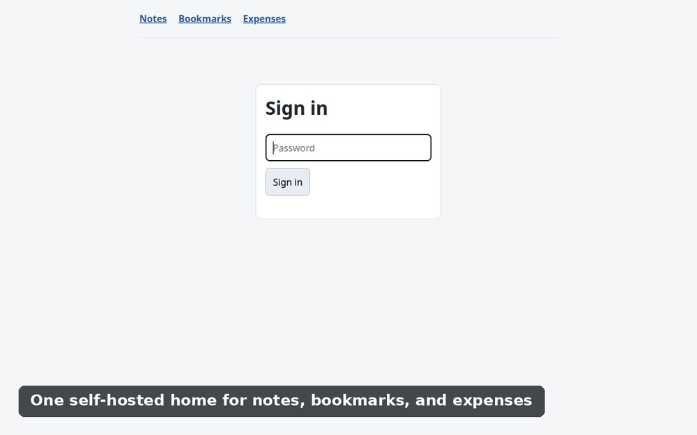
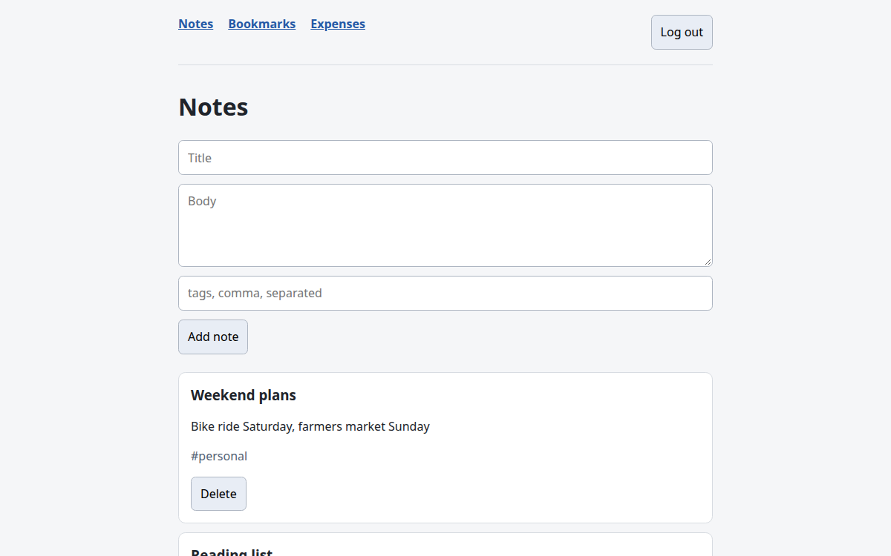
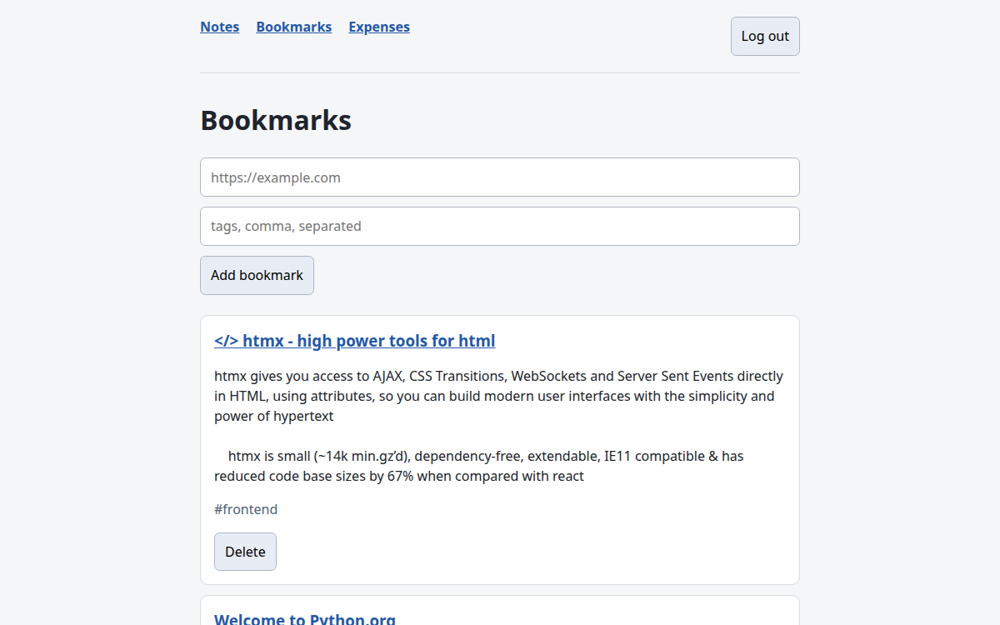
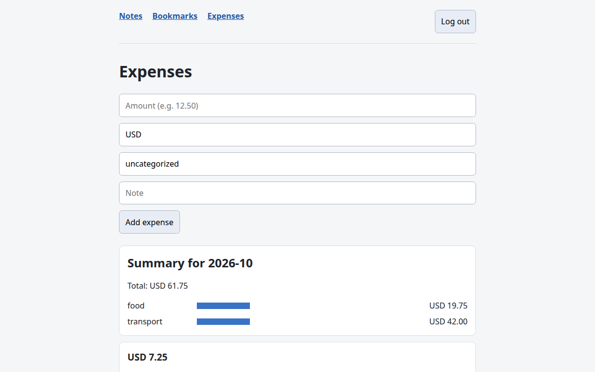
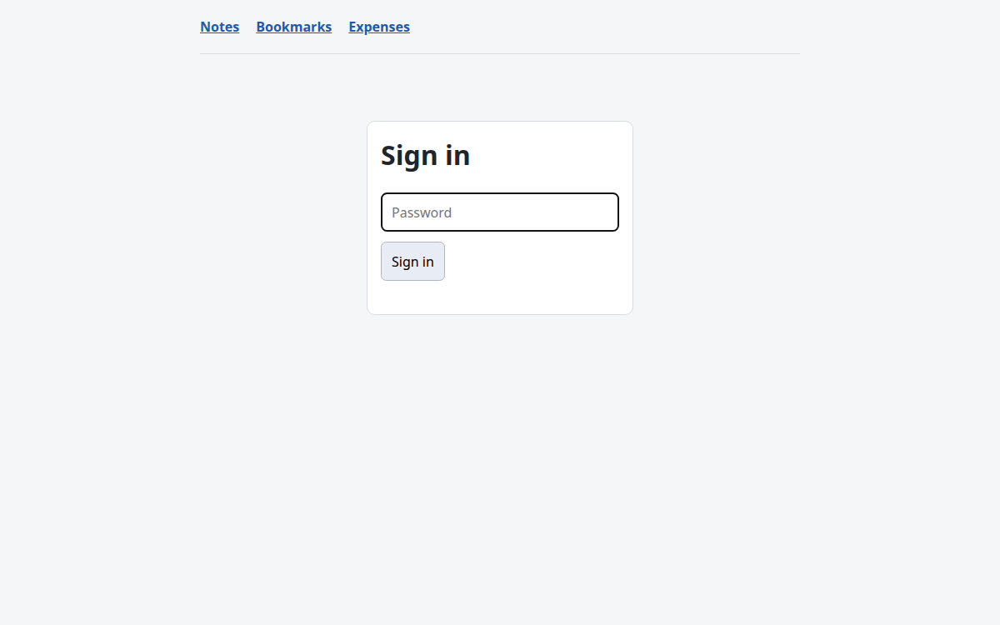

# unify

**A self-hosted personal API that unifies notes, bookmarks, and more — behind one login, one database, one deployment.**

[](https://github.com/Bidex-cmyk/unify/actions/workflows/ci.yml)


## Demo



_Recorded locally. See [docs/demo.md](docs/demo.md) to reproduce._

| Notes | Bookmarks |
|---|---|
|  |  |

| Expenses | Sign in |
|---|---|
|  |  |

## Why this exists

I wanted one place for notes, bookmarks, and the personal systems I rely on without
another SaaS subscription. I wanted to own the data, back it up, and use one small
service instead of scattering it across apps. So I built unify: a self-hosted API with
a lightweight browser UI, designed to grow alongside its data.

## Features

- Notes API with create, partial update, and soft delete; browser UI supports create and delete.
- Bookmarks API with background title and description fetching.
- Expenses module for logging amounts, currencies, and categories, with monthly summaries and an inline SVG bar chart; money is stored as integer minor units.
- HTMX UI with a signed session-cookie login.
- Bearer-token authentication for the JSON API.
- Soft deletion with explicit permanent-delete support.
- Alembic-managed database migrations.
- 95% test coverage and strict mypy checking.

## Stack

- **Backend:** FastAPI, SQLModel, Alembic, Postgres (SQLite for local development)
- **Frontend:** Jinja2, HTMX, hand-written CSS
- **Infrastructure:** Docker Compose, Caddy (deployment setup planned)
- **Tooling:** uv, Ruff, mypy, pytest, pre-commit

## Quickstart

### Try it locally with Docker

```sh
docker compose -f docker-compose.yml -f docker-compose.local.yml up --build
```

Then open <http://localhost:8000>. This starts the local Compose setup.

### Local development

```sh
uv sync
cp .env.example .env
make migrate
make dev
```

Open <http://localhost:8000>. Sign in with `UNIFY_UI_PASSWORD` from `.env`.

### Run tests

```sh
make test
```

## Architecture

Read the [architecture overview](docs/architecture.md) and [API reference](docs/api.md).
The API schema is available as [OpenAPI JSON](docs/openapi.json); when running locally,
interactive docs are at [`/docs`](http://localhost:8000/docs) and
[`/redoc`](http://localhost:8000/redoc).

## API

The Expenses API supports logging and reviewing expenses. Amounts are sent and stored
as integer minor units (for example, `1299` is USD 12.99).

| Method | Path | Description |
| --- | --- | --- |
| GET | `/api/expenses` | List expenses; supports `since`, `until`, and `include_deleted` filters |
| GET | `/api/expenses/summary?month=YYYY-MM` | Get the monthly total and totals by category |
| GET | `/api/expenses/{id}` | Get an expense |
| POST | `/api/expenses` | Create an expense |
| PATCH | `/api/expenses/{id}` | Partially update an expense |
| DELETE | `/api/expenses/{id}?hard=true` | Delete an expense; soft-deletes by default, permanently deletes with `hard=true` |

## Roadmap

- [x] Scaffold
- [x] Database models and migrations
- [x] API and UI authentication
- [x] Notes API
- [x] Bookmarks API
- [x] Expenses module
- [x] HTMX UI
- [x] Strict type checking
- [x] Coverage reporting
- [x] Public-facing packaging and docs
- [ ] Deploy to VPS (needs VPS budget)

## License

MIT — see [LICENSE](LICENSE).
